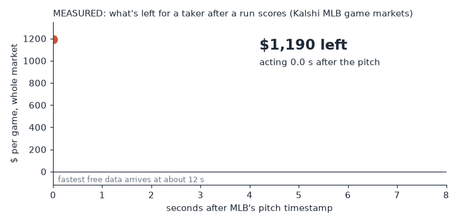
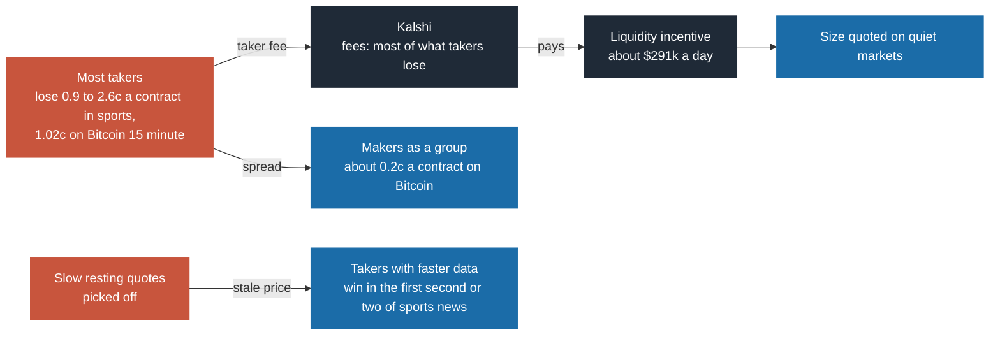

# Kalshi research, July to October 2026

A nights-and-weekends research project asking whether a small outsider can find a repeatable edge in Kalshi prediction markets: weather, Bitcoin and sports.

- A total of **23 trading ideas tested**: 22 closed on the evidence, and the paid feed sports work is still open.
- About **30 tests and gates pre-registered**, with their pass and fail rules written down before running.
- Several **real capped live trades on Kalshi**, all small, all written up (including the losses).
- Sports markets **recorded continuously since 3 September 2026** (with logged gaps), 48 series plus soccer, Polymarket and sportsbook odds.

Start here: **[Who actually makes money on Kalshi](notes/how-the-winners-trade.md)**. In four weeks of September sports, takers lost about $113 million, and about $99 million of it went to Kalshi in fees. Prints are anonymous, but the books record what the winning makers and takers do and how fast. This is their playbook as I reverse engineered it, tagged measured, simulated or inferred.

Who pays whom on Kalshi, as the tape shows it (amounts and evidence in the note):

## What this is

This repo is a curated, sanitized extract of a private research repository. In short, the edges were real and belonged to someone faster, bigger or better informed. The sports taker work is still live. Nothing here is a profit claim. Every real trade was small and capped, and each one lost money, from a 1.74c fee to $17.69. They are all written up in [notes/trades.md](notes/trades.md).

How the work gets done: I set the strategy, choose the tests and decide when an idea is dead. AI coding tools wrote most of the code in the private repo and in this one, and I use them as a second opinion on judgment too. Every number in this repo traces to a file in the private repo; the write-ups say what was measured, what was simulated and what was inferred.

## Ideas tested, and why each one was closed

Cents are per contract, net of Kalshi's taker fee where a taker is involved. Intervals are 95% and clustered by day or by game. "Closed" means the written-down kill rule fired or the number was negative with the interval below zero. "Capped live" means real orders with a hard dollar cap.

| # | Idea | Market | Period | How tested | Result | Why closed |
|---|---|---|---|---|---|---|
| 1 | Long shots are overpriced; sell them | Daily high temperature, four cities | Jul 2026 | Hourly historical price bars, 2023 on, executable prices | 14 to 17 price bins looked good at midpoints, 0 at executable prices | The spread ate it at every horizon |
| 2 | Temperature ladder does not sum to $1 | Daily high temperature, four cities | Jul 2026 | Sum of six buckets vs $1.00 on hourly price bars, at executable prices | Sell side profitable 25 of 4,288 snapshots, buy side 1 of 4,288 | True dollar sits inside a 31c spread |
| 3 | A public forecast beats the price | Daily high temperature, four cities, 2023 to 2026 | Jul to Aug 2026 | Take the side the forecast favours | -2.85c [-3.35, -2.34] | The forecast adds information, but only in legs you cannot trade |
| 4 | Be the resting seller of cheap long shots | 7 US cities' temperature | 5 years of tape (11.7M trades) plus one depth week | Maker P&L identity on history; fill simulator on recorded books | Maker population +0.63c in the 90 to 99c decile; a newcomer selling 1 to 10c long shots: provable fills -0.62c [-0.88, -0.36] (-1.47c across all quotes) | Provable fills lose: adverse move 2.15c, about 3x the half-spread, not reverting from 5 to 60 min, and a newcomer's ceiling under $5k a year. The result for a real queue position (between -1.47c and +0.47c) needs order by order data that was not collected |
| 5 | React faster to observed temperature | NYC temperature | Aug 2026 | Survey of the settlement rule and the free feeds | Settlement uses a 5-minute running mean of the station reading | The fast free feed reads the settlement value low on most days, and the accurate rebuild is no faster than the market (survey, NYC only) |
| 6 | Maker on daily Bitcoin strikes | Bitcoin daily (KXBTCD) | Aug 2026 | Replay on 90,796 markets | Registered model +0.031c [-0.064, +0.126], no edge; realistic union model -0.24c [-0.32, -0.16], n = 802,033 fills | The registered model could not show an edge (verdict of record: FAIL), and the realistic model loses |
| 7 | Maker in, maker out on 15-minute Bitcoin | Bitcoin 15-minute (KXBTC15M) | Aug 2026, 22 days, 672M book records | Replay with latency charged, order joins the back of the queue | +0.066c per round trip at zero latency; -0.120c [-0.164, -0.076] at the measured 34 ms, 20 of 22 days losing | 68% of the profit was round trips inside 50 ms; at 34 ms it lost under every queue model a joiner can defend |
| 8 | Two-sided quoter, no reaction needed | KXBTC15M | Aug 2026 | Replay at zero latency | -0.063c [-0.100, -0.027], n = 665,097 | Loses even with free, instant cancels when it joins the back and chases the touch; for a quoter that is first at new levels, see row 23 |
| 9 | Take stale quotes; or hedge maker fills on a Bitcoin perpetual | KXBTC15M | Aug 2026 | Taker markouts by quote age; hedge cost arithmetic from published fees | No stale quote to hit on the 15 minute series; the hedge costs 42 to 212 times the half-spread | Closed in the same pass as 7 and 8 |
| 10 | Post, get filled, flatten at the bid (E0) | KXBTC15M | 21 days | Full replay of the loop | -2.48c per fill [-2.55, -2.42], lost on all 21 days | The taker fee on the exit (about 1.7c) is larger than the half cent the entry earns |
| 11 | Slow one-lot maker joining existing price levels | KXBTC15M | Aug and Sep 2026 | 0 of 2,002 held-out rule cells positive | Back of queue -0.4 to -0.7c; front of queue +0.4c held to settlement, which a joiner cannot reach | Every joining variant loses; for being first at a new level, see row 23 and [notes/btc-15min-queue.md](notes/btc-15min-queue.md) |
| 12 | Quote the touch just after the open, then manage inventory | KXBTC15M | Sep 2026, capped live | 74 openings under one $10 cap | -$2.07; every one-sided market lost (6 of 6 in phase B, 29 of 29 in phase C) | Pairing rate 41% against a 78% break-even. Touch orders went out 1 to 3 s after the open and mostly sat thousands of contracts back (2 of 28 reached the front, and both markets lost), so this was not a real test of the front of the touch |
| 13 | Predict the opening price from outside Bitcoin prices | KXBTC15M | Aug to Oct 2026 | Pre-registered bar plus live shadow | Opening price: median error 2.30c vs 4.50c for a flat 50c, failing a 0.5c bar; a separate settlement forecast had live Brier 0.2565 vs 0.2500 for a flat 50c | Better than a guess but not accurate enough to quote on; trading on it lost (row 16) |
| 14 | Hold early-market maker fills to settlement | KXBTC15M | Aug estimate, Sep confirm | Pre-specified cell, see [preregistrations/](preregistrations/) | -0.71c Aug, -0.85c Sep, negative on 31 of 32 days | The early edge exists but belongs to the front of the queue |
| 15 | Depth behind you protects a quote | KXBTC15M | Aug to Sep 2026 | Cancel rule vs a free age timer | It predicts which fills get run over, but does not pay | A free age timer beats it, and the timer still loses |
| 16 | Take the stale opening price in the first second | KXBTC15M | Sep 20 to Oct 3, 2026 | 7-day holdout, rules fixed in advance | -19.8c per trade on the holdout, 0 of 7 days positive | A flat 50c guess did better |
| 17 | Takers or makers win in some sport | Sports series on two recorders (MLB, NFL, college football, NHL, tennis, soccer) | Sep 2026, 46M trades, 223k markets | Settlement P&L by side, per sport, holes filled from Kalshi's public trades | Takers -0.9 to -2.0c in every sport (NHL's interval includes zero); makers flat | Most of what takers lost went to Kalshi's fees, not to makers |
| 18 | Follow Polymarket into Kalshi | Sports game markets | Sep 2026 | Three rounds, cells fixed before running | -2.6c; then -0.97c at our receive time; +2.2c at an unattainable timing; -0.62c once retimed from raw ticks | The +2.2c was a timestamp artifact; see [notes/polymarket-timestamp.md](notes/polymarket-timestamp.md) |
| 19 | Pre-game gap between Kalshi and sportsbook consensus | MLB, NFL, soccer | Sep to Oct 2026 | Minute-by-minute census | Executable gap in about 5% of MLB game-minutes, typically 0.2c past the fee | Rarely past the fee, and the consensus is no better a forecast than Kalshi |
| 20 | Collect Kalshi's liquidity incentive on a quiet market | Miami temperature | Oct 2026, capped live | 1c cheap-side quotes, $20 at risk | 2,000 contracts filled, all lost; $2.31 reward, -$17.69 net | The 1c quotes were swept within 1 to 40 s, so the cheap-side tactic is dead. Full-size two-sided quoting is untested live, and the payout formula was neither confirmed nor refuted |
| 21 | Fast follower off large one-sided bursts on Kalshi's own tape | MLB game markets | Sep 2026 | 72-cell grid declared in advance | Headline -0.65c in sample, -0.76c on the holdout; best of 72 cells +0.94c on the holdout but +0.10c [-3.84, +4.03] at settlement | Dead as a business: one lot makes about $0.63 a day and sizing up loses |
| 22 | A paid sports feed as the speed signal | Soccer, 59 leagues | Oct 2026, one trial weekend | 1,399 goals, 826 with a Kalshi move | On 560 cleanly timed goals, first report a median 4.5 s after Kalshi's price burst, first on under 1%; on all 826, a median 4.1 s after Kalshi's half way point | Too slow; see [notes/sports-speed.md](notes/sports-speed.md) |
| 23 | Continuous quoter: price from live Bitcoin all fifteen minutes, be first at each new level | KXBTC15M | Aug, Sep and early Oct 2026 tapes | Replay at 3 to 35 ms, rules and kill rule written down first, rebuilt independently | -0.49c [-0.63, -0.35] Aug, -0.65c [-0.90, -0.40] Sep, -0.89c [-1.08, -0.71] Sep 20 to Oct 3, every cell negative | My Bitcoin model priced worse than the book's own mid, two thirds of fills were sweeps straight through the quote, and fills at levels it created did not pay; see [notes/btc-15min-queue.md](notes/btc-15min-queue.md) |

Two retractions belong in this table too. Two headline microstructure findings on Bitcoin were withdrawn. One compared an average over all fills with a loss measured only on fills that failed to pair. The other split fills by queue position, which selects on distance from the mid and biases a same-side markout. Separately, a Westfall-Young correction on two 20-cell families (August and September) cut 14 significant cells to 11 and 5 to 4; the headline cell held. The correction is in [code/stats.py](code/stats.py).

## What I am working on now

Being picked off within seconds on Bitcoin is what turned me around: someone was making money hitting my quotes, and I wanted to know what it takes to be on that side. Sports is where that is possible for an outsider, because the news is a goal or a run, most of the market learns it seconds late, and faster data can be bought.

The measured value-of-latency curve for baseball says the whole market's take after a run scores is about $1,190 a game for a taker acting at the pitch stamp, $472 one second later, about $50 at three seconds (interval includes zero) and nothing after five. The fastest free data I found arrived about 12 seconds after the pitch, measured on one game's five scoring plays. So the current work is on paid data: trial feeds, calls with several sports data vendors, a written answer from Kalshi's compliance team that no rule prohibits paid feeds, and measurement of where a feed can arrive first. The first trial feed was behind Kalshi's price on over 99% of the goals that could be timed cleanly. I have set aside my own money for data and am still working out which leagues and which feed can be first.

On Bitcoin, the last piece I had not run, a quoter that prices each contract from live Bitcoin for all fifteen minutes and is first at each new price level, has now been replayed on three separate sets of recorded books, August to early October, and it lost on all three. Every form of a small outside maker I could build has lost. What is left would need a different input: a fair value better than the book itself, built from the fast order books of the exchanges behind the settlement index, or the access and size of a market maker.

## Map of this repo

| Path | What it is |
|---|---|
| [notes/how-the-winners-trade.md](notes/how-the-winners-trade.md) | Who makes the money on Kalshi and how: queue position and fast cancels on Bitcoin, favourite selling on weather, pulling at the snap and first second taking in sports, the incentive pool |
| [notes/btc-15min-queue.md](notes/btc-15min-queue.md) | Two months on the 15-minute Bitcoin contract: latency, queue position at the open, and why the front of the queue was not enough |
| [notes/sports-speed.md](notes/sports-speed.md) | Takers lose in every sport; what a second of latency is worth in baseball; the soccer feed trials |
| [notes/weather-fill-sim.md](notes/weather-fill-sim.md) | Five years of temperature tape, the fill simulator that closed the weather maker, and the expired-ticker lesson |
| [notes/polymarket-timestamp.md](notes/polymarket-timestamp.md) | How a +2.2c signal became -0.6c once it was timed the way a live reader would see it |
| [notes/trades.md](notes/trades.md) | Every real trade: two one-contract Bitcoin round trips, three capped phases at the open, and a Miami incentive test |
| [preregistrations/](preregistrations/) | Three real pre-registrations, lightly sanitized, each with a note on what happened afterward |
| [code/fees.py](code/fees.py) | Kalshi taker fee; the test reproduces all 42 cells of the published fee table |
| [code/stats.py](code/stats.py) | Day-clustered CR1 interval and a Westfall-Young max-t correction, with synthetic tests |
| [code/queue_model.py](code/queue_model.py) | A toy price-time queue showing why back-of-queue fills are the bad ones |
| [charts/](charts/) | Every chart, with the script that regenerates it from [data/](data/) |

To run the code: `pip install -r requirements.txt`, then `pytest code/tests` (41 tests) and `python charts/make_charts.py`. Python 3.11 or newer, numpy, matplotlib, pytest. No private data is needed.

Things deliberately left out: credentials, server details, raw market data, vendor names and anything about my day job. The private repo also holds the recorders (one of them took in 149.8 million market data records from 16,672 market streams in one 88-hour window), the replay and integrity gates, and about 30 frozen pre-registration documents; those stay private.
