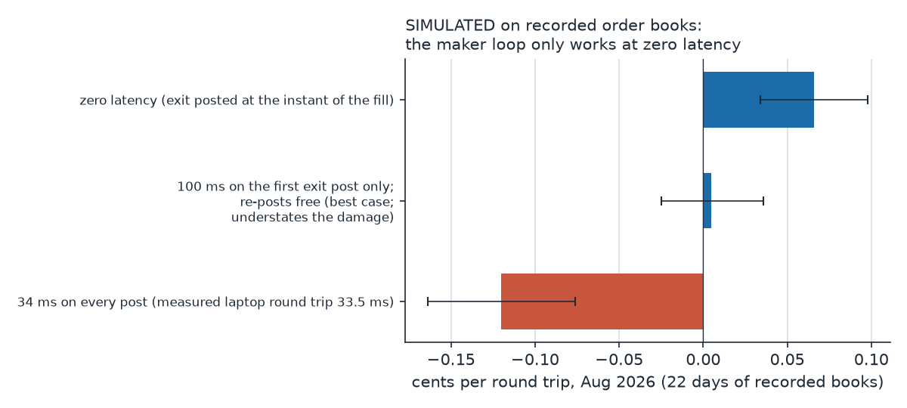

# Two months on the 15-minute Bitcoin contract

Kalshi's KXBTC15M market asks whether Bitcoin will be above a strike fifteen minutes from now. A new one opens every fifteen minutes, it settles on CF Benchmarks' Bitcoin index, and in September 2026 it traded about 1.4 billion contracts a week. I spent most of August and September on it. Every number below comes from my own recordings and replays unless it says otherwise.

## The maker loop looked profitable, then I charged for time

A maker-in, maker-out loop (post at the touch, get filled, post the exit at the touch) replayed at +0.066c per round trip on 22 August days of recorded order books (672 million records, 1,991 markets). Like every replay in this note, its orders joined price levels other people already held. Then I asked where the profit came from. 68% of it was round trips that opened and closed within 50 milliseconds, and 80% within 100 ms. The simulator was posting the exit in the same instant as the entry fill. My laptop's measured round trip to Kalshi was 33.5 ms. Charging 100 ms on the first exit post only, with re-posts still free, took it to +0.005c with the interval spanning zero. Charging 34 ms on every post, which the exit rule requires, gave -0.120c [-0.164, -0.076] and 20 losing days of 22. A two-sided quoter that needs no reaction at all lost -0.063c [-0.100, -0.027] at zero latency. Two independently written implementations agreed.

## Moving to Ohio cut the round trip, and the queue bought nothing

I moved the trading host to servers in the same AWS region as Kalshi's. A warm request fell from 33.5 ms on the laptop to about 3 ms, and an order creation at an open cost about 9 ms round trip. The network leg of that is 0.2 to 0.7 ms; the rest is the exchange's own processing. Private network links need account tiers far above mine. FIX order entry was reachable with its own key but uses the same rate limits as REST, and Kalshi documents no queue priority or colocation for any tier.

The open is the one moment when every price level is empty at once. During the market a level is empty only at the instant it forms, and within 5 ms the typical new best level already has about 680 contracts queued. Kalshi signs the request path and timestamp but not the body, so orders can be signed ahead of time and fired on a schedule. I sent bursts of pre-signed orders on a 3.5 ms grid around each open, with send deadline error under a microsecond. The venue accepts an order exactly when it arrives at or after the open time, and that boundary is in arrival time, not send time. Of the 8 orders the exchange accepted on the best run, 7 came back at queue position 0, and on one opening all five accepted orders were the front of the book. Those probes were 1 cent bids, far from any trading, so they could not fill. In a later live run a burst at 30 and 70 cents also reached position 0 repeatedly. At the best bid and offer, where the trading happens, my 28 measured phase B orders sat a median of about 3,000 contracts back (range 0 to 10,505). Two were first in line, and both of those markets lost. Queue position does not reward sub-millisecond send precision; what it rewards is being inside a window of roughly 0 to 1.5 ms of arrival after the open, and inside that window the queue fills at 100 to 320 contracts per millisecond.

Then the question I should have asked first: first in line, but at what price? The strike is only populated when the market goes active, so nobody can know a new contract's fair value before it opens. I used Coinbase as the reference price because it agreed with the direction of Kalshi's settlement on 966 of 978 markets. My later model predicted Kalshi's price five seconds after the open with a median error of 2.30c, against 4.50c for a flat 50 cents, but it missed its pre-registered 0.5c bar. An earlier 6.87c figure was inflated by comparing against a 47 second old price. A separate model's settlement forecasts did worse live than a flat 50 cents (Brier 0.2565 against 0.2500).

## Three capped live phases, -$2.07

I traded the open anyway, under one $10 cap that was never reset, across three phases with increasingly careful inventory handling. Across 74 openings the cumulative result was -$2.07. In the last phase, managed inventory cut the loss per one-sided market by 4x compared with the phase before it (though 80% of that came from two bad exits in the earlier phase), and every one of the 29 markets where only one side filled still lost. Bitcoin would move, and within seconds someone hit the stale side of my quote. The pairing rate fell from 57% to 41%. My leading explanation, not proven, is that the re-quote was a cancel-and-replace that threw away the resting exit's place in line. Details and the reconciliation are in [trades.md](trades.md).

I then tried the other side: buying the stale opening price in the first second when my reference estimate disagreed with Kalshi's mid by 3c or more. With rules fixed before the holdout week was opened, it lost 19.8c per trade [-31.5, -8.1] over 61 trades, negative on all 7 days, and a placebo of guessing a flat 50c did better.

## What is actually established

Makers as a group earn about +0.20c per contract gross in steady state, measured on every public print from a minute after the open to the close in one September week (1.44 billion contracts); Kalshi's fee take is about 4x that. First-second takers are inconclusive: +5.6c, -6.1c and +1.8c across three periods with every interval spanning zero. A slow one-lot maker joining an existing queue loses in every runnable variant: back of queue -0.4 to -0.7c, 91% of never-cancelled orders run over within two minutes, half of them within about 3 s, 0 of 2,002 held-out rule cells positive. The same orders placed at the front of the queue would make +0.4c, but a joiner cannot get there by construction. Getting there means being first at a new level, which I reached only with deep 1 cent probes at the open and never tested at the touch during the market.

The last piece was the machine itself: a quoter that prices each contract from live Bitcoin for all fifteen minutes and is first to post at each new price level, rather than joining a level someone else holds. Every replay above joined, so I wrote down the rules and a kill rule, then replayed it on the recorded August, September and early October books at 3 to 35 ms. It lost on all three: -0.49c [-0.63, -0.35], -0.65c [-0.90, -0.40] and -0.89c [-1.08, -0.71] per filled contract, with every one of 22 cells negative in every month. A second, independent implementation reproduced September to 0.003c. (Simulated.) Three things sank it. My model, live Bitcoin plus a volatility estimate, forecast settlement worse than the book's own mid at every horizon. Between 61% and 66% of fills were sweeps straight through the quote, which lost 1.0 to 1.5c each. And the fills at levels the quoter created itself, 1.4% to 4.8% of postings, did not pay; a slower quoter creates more of them because its stale quote sits where the market has already left. (Measured on the replay.) Being first only pays if you also know the price better than the book does. Beyond it, whether a market maker agreement or real size changes anything is unknown. My round trip was mostly the exchange's own processing, which no connection upgrade I could find would shorten. That is the version of this market I would want to revisit with the resources of a desk.
