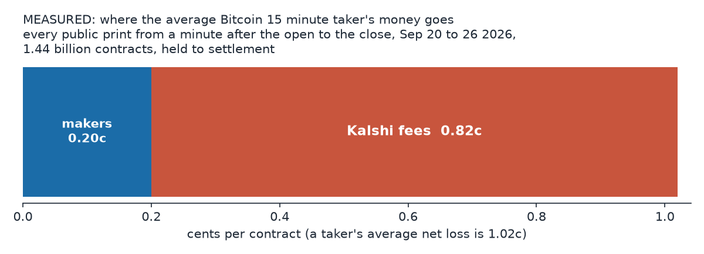
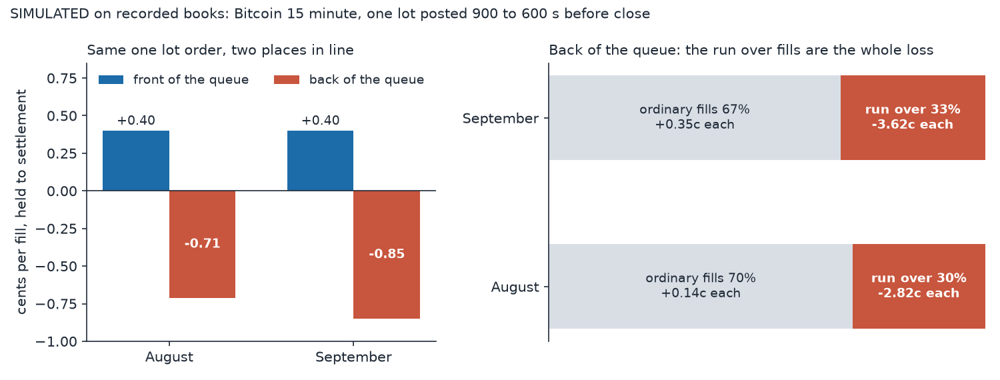
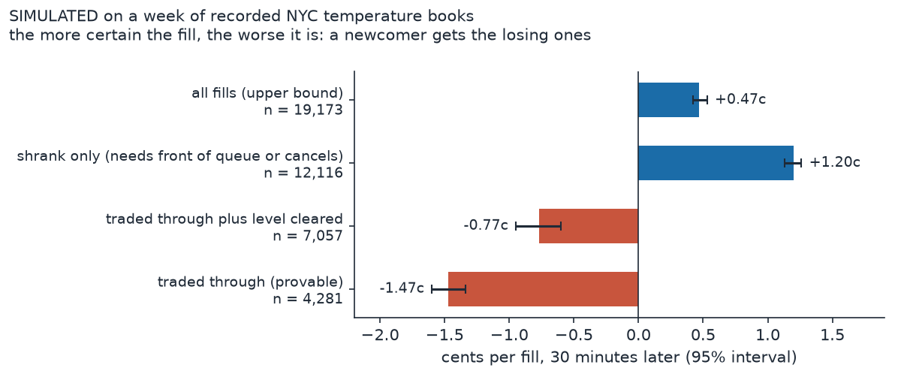
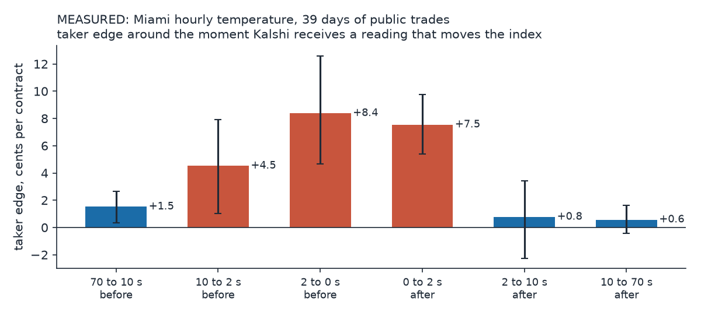
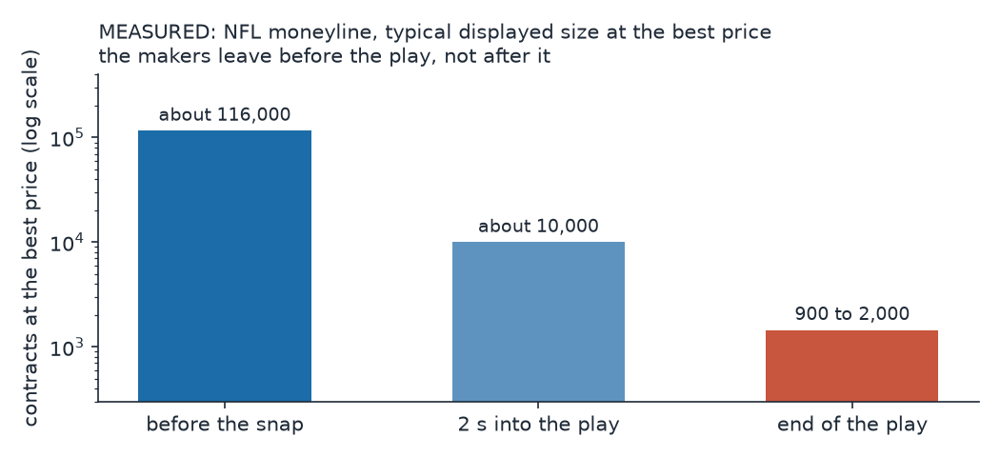

# How the winners trade on Kalshi, reverse engineered from the tape

Nearly every idea in this repo closed the same way: the edge was real, and someone else already had it. This note is about that someone. Kalshi's trade prints are anonymous, so I cannot name anyone. But the order books and prints record what the winners do, when they do it and how fast, and after three months of losing to them I can describe much of their playbook, and say exactly where my evidence stops.

Each claim is tagged. Measured means computed directly from recorded data. Simulated means a replay on recorded books under stated assumptions. Inferred means reasoned from those numbers, and could be wrong. Cents are per contract.

## The short version

1. On Bitcoin 15 minute contracts, makers as a group keep about 0.2 cents a contract, and a fully paired round trip keeps about half a cent. That most likely goes to whoever is first in line when a price level forms and can live with the inventory. My orders were fast, about 9 ms from Ohio, but I never tested speed and a live pricing model together. That test is next.
2. On weather, makers win by collecting the one cent tick from heavy retail taker flow, at size, from a place already in the queue. A newcomer at the back gets mostly the fills that are about to lose.
3. In sports, makers pull their orders when news happens. Takers win only with a data source faster than everyone else's, inside the first second or two.
4. Kalshi also pays about $291,000 a day to resting liquidity. Whether that pays for getting picked off depends on how much news a market gets.
5. Everyone else pays the spread and the fee.

## 1. Bitcoin 15 minute: the fast maker

Makers as a group make money, barely. Over one September week, on the 1.44 billion contracts traded from a minute after the open to the close, makers earned 0.20 cents a contract before fees, and takers lost 1.02 cents after fees. Kalshi's fee take was about four times what makers earned. (Measured.)

Where a maker's money comes from. On September maker fills where the recorded book shows the real bid and ask, the half spread earned was 0.368 cents and over the next 5 seconds the price moved against the maker by 0.285 cents, leaving about 0.08 cents a fill (0.19 on a larger subset). The business is collecting half a tick and giving most of it back to adverse selection. (Measured, marked to the mid.)

Speed matters, but on its own it does not decide. In a replay of August's books, 68% of a simple maker loop's profit came from round trips that opened and closed within 50 milliseconds. Charged my laptop's 34 ms round trip, the loop lost on 20 of 22 days. With zero latency, cancels free and instant, it made only 0.066 cents a round trip, and a plain two sided quote lost even then. (Simulated.) Every replay I ran put my order at the back of a level someone else already held, so going faster did not move me forward in line.

Queue position is what separates the winners. I simulated the same one lot order, posted in the first five minutes of the market and held to settlement, at the front and at the back of the queue:

| position | August | September |
|---|---|---|
| front of the queue | +0.40c | +0.40c |
| back of the queue | -0.71c | -0.85c |

The back lost on 31 of 32 days. (Simulated.) The difference is not luck. The front gets 6.8 to 7.8% extra fills that the back never sees: a small trade nibbles the level, and the price then holds. Each of those earns about 16.5 cents. (Simulated.)

Why the back of the queue loses. About 30% of a slow order's fills arrive only after everyone ahead of it cancelled and the price ran straight through. Each of those "run over" fills lost 2.8 cents in August and 3.6 in September, which is more than the whole loss. The rest of the fills made a small profit. The longer an order rests, the worse it gets: run overs were 11.6% of fills in an order's first 10 ms and 69.2% after 95 seconds. An order that has sat for a minute and a half is one nobody wants to trade with, so the only thing left that fills it is a sweep. (Simulated.)

So the winners are early in line and leave before the sweep. (Inferred.) In the middle of a market, the front of a level belongs to whoever posted there when the level formed, which happens every time Bitcoin moves. Within 5 ms the typical new best level already has about 680 contracts queued. (Measured.) To be first you have to know where the price should be the moment Bitcoin moves, so speed and a live pricing model work as one machine. (Inferred.) Cleverness at the back does not replace position. Even a cancel rule handed perfect hindsight about which fills would run over made only 0.05 cents in August, with an interval straddling zero, and 0.29 in September. That is a ceiling no one can actually run. (Simulated.) At the back, nothing I could run saves you.

What the fast makers watch. The order book itself, more than the Bitcoin price. Kalshi's own book flagged the bad fills better than an outside Bitcoin feed (lift 3.67 vs 2.44 in August, 3.17 vs 2.01 in September; the outside feed figures come from a different pipeline, so the gap has no error bar). And there is no easy warning window. On US equities, one exchange found a moment covering under 0.01% of the day that drew a third of aggressive flow. The best I could find on Kalshi concentrated flow only about 4 times. (Measured.) The pickers do not wait for an obvious signal.

The open. The open is the one moment when every level is empty at once. From a server in Ohio, where an order took about 9 ms round trip, nearly all of it the exchange's own processing, I reached the front on 7 of 8 accepted orders. But those were 1 cent bids placed where nobody trades, to cap the risk. At the best bid and offer, my 28 measured orders in the next live phase sat a median of about 3,000 contracts back. Two were first in line, and both of those markets lost. (Measured.) My best opening model beat a flat 50 cents (2.3 cents median error against 4.5) but was not accurate enough to quote on. (Measured.) Even a perfect opening quote, first every time, was worth only about $47,000 to $93,000 a year to the whole market. (Simulated.) If there is real money here, it must be in the rest of the fifteen minutes, which I have not yet modelled. (Inferred.) Whether the people hitting stale opening quotes in the first second profit is unclear: their net was positive in two periods and negative in a third, and every interval crossed zero. (Measured, inconclusive.)

What I have not tested yet. Every strategy I replayed joined price levels other people already held, which puts it at the back of the line by construction. The machine the winners probably run, a quoter that prices each contract from live Bitcoin all fifteen minutes and is first to post at each new level, has not been tested. That is the next test, on the recorded August, September and early October books. Beyond that, real size and the terms of a market maker agreement are things no outsider can see.

## 2. Weather: collecting the tick

Five years of every trade. Kalshi publishes every historical trade with the taker's side. Across seven cities from 2021 to 2026, 559 million contracts, I computed maker P&L at settlement as an exact identity. Makers whose side was priced 90 to 99 cents, that is, who sold 1 to 10 cent long shots to takers, earned 0.63 cents a contract over the five years and 0.83 cents in 2025 to 2026. That bucket holds nearly half the volume. Before 2025 every city was flat or negative, and the turn arrived with the volume. (Measured.) Both price extremes were positive, which fits impatient retail takers paying the one cent tick rather than a bias on one side. (Inferred.)

A newcomer gets the bad fills. In a fill simulator on a week of New York order books, the fills I could prove happened, where the book traded through my quote, lost 1.47 cents each across all quotes, and 0.62 cents for the long shot trade itself. The price kept moving against them by 2.15 cents, three times the half spread, and had not come back an hour later. The profitable fills were all in the tier where my order would have needed the front of the queue, or someone else's cancel. (Simulated.) A real queue position lands somewhere between those tiers, and pinning it down needs order by order data I did not collect. The incumbents keep the good fills because they are already in line. (Inferred.)

Miami: a race that lasts four seconds. Kalshi's hourly Miami temperature settles on an average of five airports' readings. Kalshi itself shows each new reading publicly about 2.5 minutes after the minute it measures. Across 39 days and 11 million contracts, takers who traded within 2 seconds of Kalshi receiving a reading that moved the index earned 7.5 to 8.4 cents a contract, and about 90% traded in the direction of the move. Two seconds later the edge was gone. (Measured.) Someone polls that reading very fast and trades on it. (Inferred.) The 1 cent quotes I posted in my live test were hit within 1 to 40 seconds of posting; all 2,000 contracts that filled lost. (Measured.)

## 3. Sports: pull at the snap, take inside the first second or two

The public pays. Across 46 million recorded sports trades, with the recorder's holes filled from Kalshi's public trade record, takers lost 0.9 to 2.0 cents a contract in every sport (NHL's interval includes zero). Makers as a group were roughly flat, and Kalshi's fees were about seven times what makers netted. (Measured.)

Football: makers vanish at the snap. At the snap, the typical displayed size at the best NFL price is about 116,000 contracts. Two seconds into the play it is about 10,000. By the end of the play it is 900 to 2,000. About a third of a touchdown's price move happens before the NFL's own end of play timestamp. (Measured.) Makers pull their orders within about two seconds of the snap, so there is little stale size left for a fast feed to pick off. (Inferred.) A fast NFL taker at the official stamp makes about 0.9 cents, and nothing one second later. (Measured.)

Baseball: someone is faster than a human can be. After a run scores, the fastest takers trade 0.6 to 0.9 seconds after MLB's own pitch timestamp. That timing is the same on singles that score a runner from second. (Measured.) Nobody watching could know that run would score so soon, so they are probably reading a machine or official data feed. (Inferred.) The whole market's take falls from about $1,190 a game at the pitch stamp to $472 one second later, and to about $175 and $50 at two and three seconds (both intervals include zero), then nothing after five. (Measured.) A person in the stands pressing a button is 1 to 2 seconds behind on a home run and 5 to 8 on other runs, which puts them near the end of that curve. (Inferred from timing.)

Soccer: a second trial feed, with scouts in the stadium, is still being evaluated, and its results stay private for now.

The price is made on Kalshi. In game, sportsbook odds appear to follow Kalshi, on a 60 second odds feed and on one night of a fast relay; a direct fast sportsbook feed was not tested. On goals, Kalshi's price is half way through its move about 0.3 seconds before Polymarket's, if the two venues' clocks agree. A signal that seemed to show Polymarket leading Kalshi by 2.2 cents was a timestamp artifact and lost 0.6 cents once retimed from the raw ticks ([notes/polymarket-timestamp.md](polymarket-timestamp.md)). The fast money is not arbitraging other venues. It is setting the price. (Inferred.)

Before the game, I found no sign of informed flow in the scheduled windows I screened, though one informed account could hide in anonymous prints. Kalshi's pre-game price sits on the sportsbook consensus. (Measured.)

## 4. The incentive money

Kalshi pays a liquidity incentive to resting orders: about $291,000 a day over one week, spread over about 30,000 markets, and none on sports game markets. (Measured.) The rules shape who earns it. The size target counts everyone's orders on a side, a market pays nobody in any second when either side's total is below the target, the reward is your share of the size, and any reward under $1 per program is not paid. (From Kalshi's rules; my simulations had missed the $1 floor. My live test, a $2.31 reward against a $17.69 loss, neither confirmed nor refuted the formula.) A one lot quoter in a few markets earns nothing.

Whether a big quoter makes money from it is not settled. In my simulation on 72 hours of recorded books, quoting the full target on both sides netted $1,600 to $2,900 a day on slow markets chosen in advance, and lost $6,500 to $61,000 a day once live sports props were included, because those were swept whenever something happened. (Simulated, before the $1 payout floor was known.) So the incentive covers being picked off only where little news arrives. Scale spreads the losses out and covers fixed costs, but it cannot turn a market that loses on average into one that pays. (Inferred.)

## What it adds up to

The playbook, as best the public record shows it:

- Be first in line when a level forms, and leave before the sweep. Queue position mattered more than any price signal I tested.
- Quote size where news is slow, and collect the spread, and where it pays, the incentive, from retail flow that pays the tick.
- Get out when news happens. At the snap, at the pitch, at the reading.
- Take only with information nobody else has yet, and only inside the first second or two.

None of this is magic. It is a pricing model, infrastructure, capital and data working together, and three months of losing taught me which piece I was missing each time. The Bitcoin quoter test and the sports feed work are my attempts at the first and last items.

## How these numbers were made

The Bitcoin replays used 672 million recorded book records from 22 August days, with every September market as the out of sample check. The per-sport money figures come from a server that has recorded Kalshi's sports series since 3 September, with its holes filled from Kalshi's public trade history (in 85,582 of the 85,587 repaired markets the public trades sum exactly to Kalshi's volume). The latency curves use their own merges of tape and public prints. Intervals are clustered by day or by game, and many sweeps were corrected for multiple testing ([code/stats.py](../code/stats.py)). Several headline findings along the way were retracted when a markout turned out to carry half the spread by construction. That trap appears several times in the private repo, and the headline numbers above are marked to settlement or to an executable price, or checked against settlement where they are marked to the mid.
