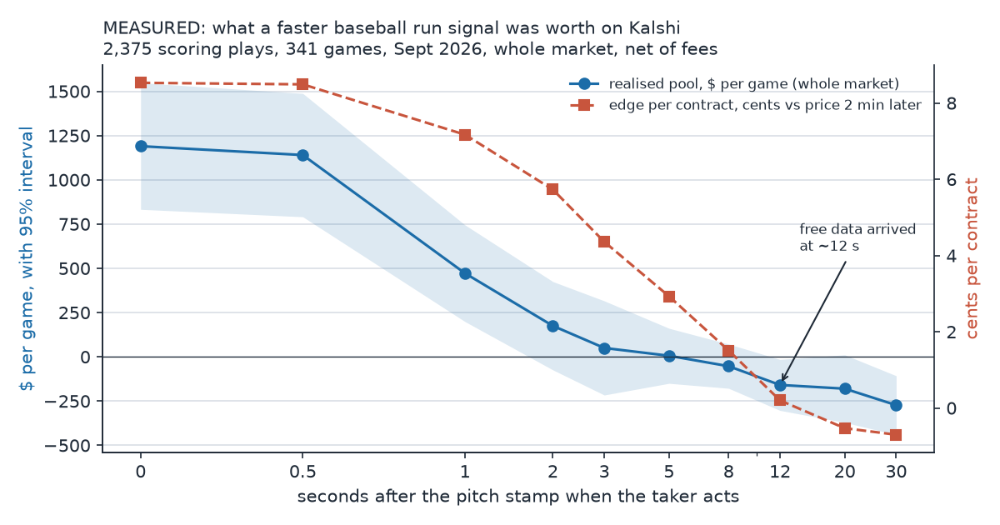
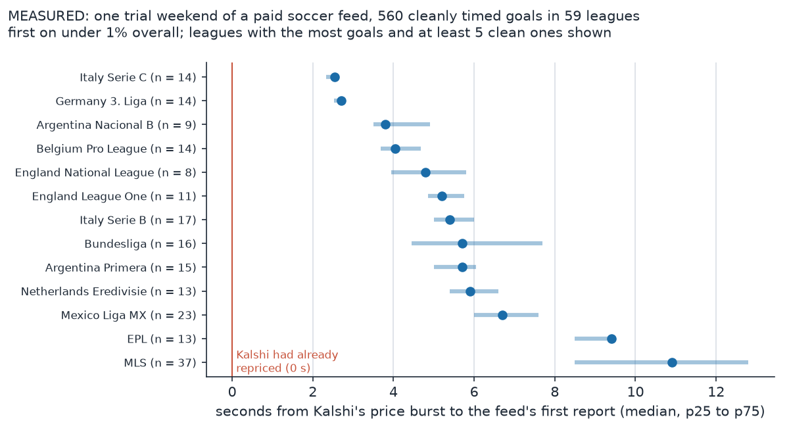

# Sports: who wins, and how fast you have to be

Since 3 September 2026 a server has recorded most of Kalshi's major sports markets continuously, with logged gaps: 48 series across baseball, football, basketball, hockey and tennis, with a second machine for soccer and a third for Polymarket and sportsbook odds. This note covers what four weeks of that tape said about takers and makers, how much a second of latency is worth, and what two feed trials found. All numbers are measured from recorded data unless marked inferred.

## Takers lose in every sport

Across 46,334,835 recorded trades (September 3 to October 1), after filling the recorder's holes from Kalshi's public trade record, the average taker lost 0.9 to 2.0 cents a contract after fees in every sport (NHL's interval still includes zero), and no sport's maker result could be told apart from zero.

| sport | games | taker net, cents [95% CI] | maker net, cents [95% CI] |
|---|---|---|---|
| MLB | 359 | -0.90 [-1.45, -0.36] | +0.21 [-0.33, +0.75] |
| NFL | 48 | -2.03 [-3.57, -0.49] | +0.61 [-0.93, +2.15] |
| tennis | 467 | -1.35 [-1.92, -0.77] | +0.01 [-0.58, +0.60] |
| NCAAF | 545 | -1.05 [-1.90, -0.20] | -0.29 [-1.14, +0.56] |
| soccer | 279 | -1.77 [-3.07, -0.48] | +0.60 [-0.69, +1.89] |
| NHL | 67 | -1.67 [-5.24, +1.91] | +0.41 [-3.17, +4.00] |

Of the $113.4M takers lost, $99.2M was Kalshi's fees and $14.3M reached makers. Before the repair the tape showed makers keeping $25.8M; the recorder had missed most trades on NFL Sunday afternoons, and the missed trades were the taker-favourable ones.

## What a second is worth in baseball

Takers lose on average, so the question became whether a fast taker wins. I anchored every scoring play on the pitch-level start time from MLB's public play feed and measured what a taker who learns of the run L seconds later earns by hitting the stale displayed price, net of fee, against the price two minutes later. The chart is selection-free: non-scoring plays and a +60 s placebo both sit at minus the cost of taking at every L, so the method does not manufacture edge.

The per-contract edge decays by half at about 3 s and is gone by 12 s. The dollars go much faster because the stale size at the touch collapses from a median 673 contracts at L = 0 to 93 at 1 s: the first takers sweep it. The realised pool for the whole market is about $1,190 a game at L = 0, $472 at 1 s, about $175 at 2 s (interval includes zero), about $50 at 3 s and nothing from 5 s on. The market's fastest takers arrive 0.6 to 0.9 s after the pitch stamp, with the same timing on singles that score a runner from second, where nobody watching could know the run will score yet, so they are probably using a machine feed (inferred). The fastest free paths I found (a cache-busted public API polled once a second, or MLB's public push socket, whichever came first) showed the run a median 12.3 s after the pitch, on one postseason game's five scoring plays. A one-contract taker never makes real money at any latency: the per-play edge is a few cents and there are about 85 scoring plays a day. The pool is in size, and size is gone within a second.

Kalshi's own tape as the signal (the "fast follower") was tested on a 72-cell grid declared in advance. Its triggers were large one-sided sweeps on Kalshi's own tape. The headline rule lost 0.65c in sample and 0.76c on the holdout. The best of the 72 cells made +0.94c on the holdout markout but +0.10c [-3.84, +4.03] at settlement, one lot of it makes about $0.63 a day, and sizing up to the touch loses money, so it is dead as a business.

## Two soccer feed trials

Soccer has a measured pot and the news is a goal, so I went after paid data. Several sports data vendors were called; Kalshi's compliance team confirmed in writing that no rule prohibits paid commercially available feeds.

Trial one was a feed whose top league goals look television sourced (inferred; the feed carries no source field) and which waits for a second source before confirming. Over one weekend I derived 1,399 goals across 59 leagues; 826 had a Kalshi price move of at least 4c. On the 560 goals where Kalshi's price burst could be timed cleanly, its first report came a median 4.5 s (p25 2.8, p75 6.3) after the burst, and it was first on under 1%. Across all 826 it arrived a median 4.1 s after Kalshi's price was half way through its move, and was ahead of that point on 4%. Its confirmed report came a median 12 s after the burst. Top leagues were worse (EPL 9.4 s). It was first on only a handful of cleanly timed goals, in small leagues (2 of 14 in Italy's Serie C, 1 of 2 in the Dutch second division), far too few to build on.

Trial two, a feed with scouts in the stadium, is under evaluation and its results are not public.

Where this leaves me: measuring the specific leagues where the in-stadium race is thin, deciding which feed can be first there, and a live one-match test that logs my own receive time against the feed stamp and the first Kalshi print, with no orders.
